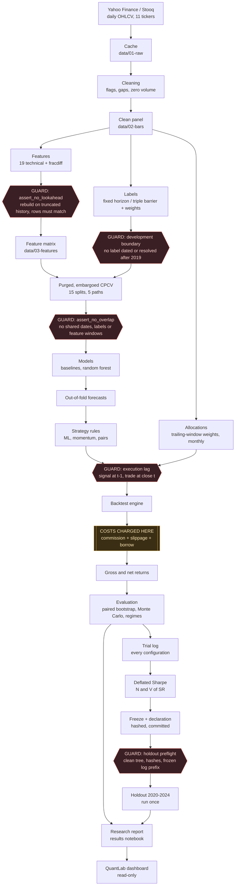
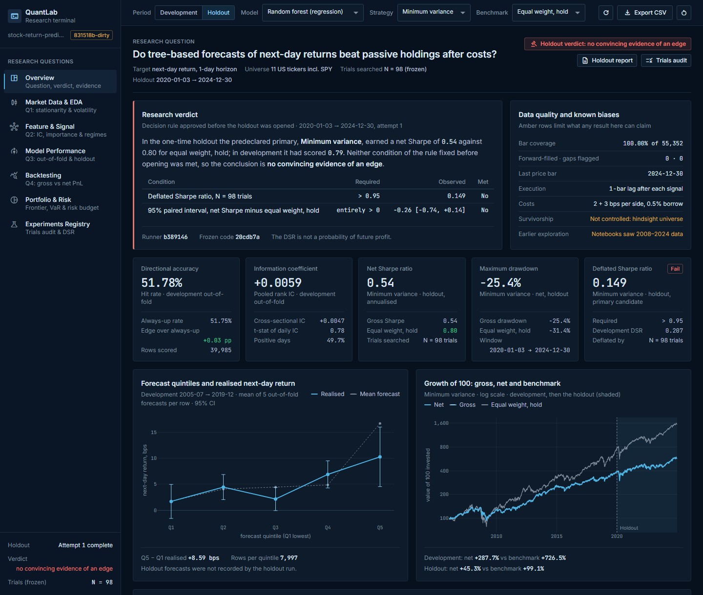
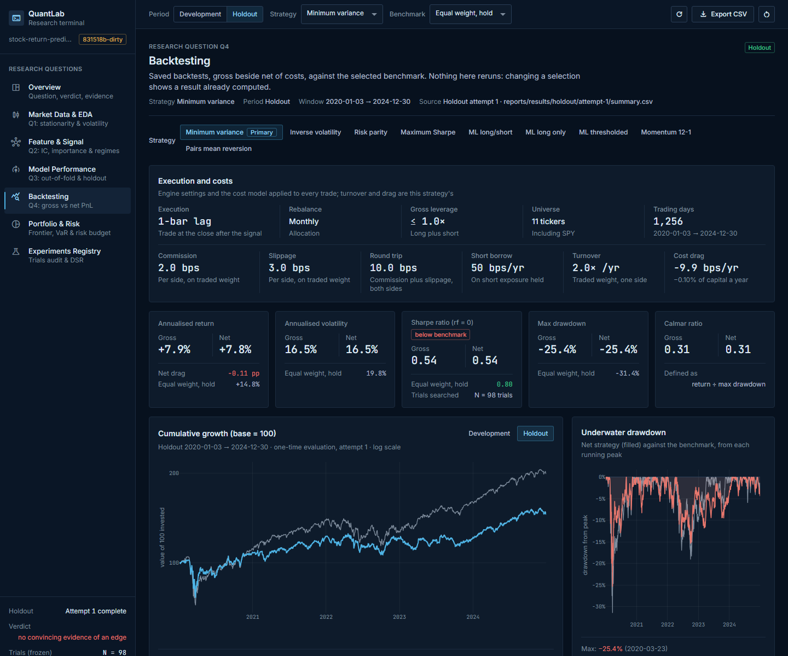
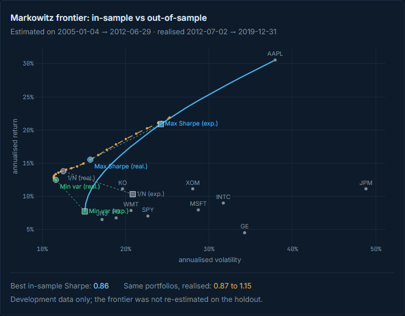
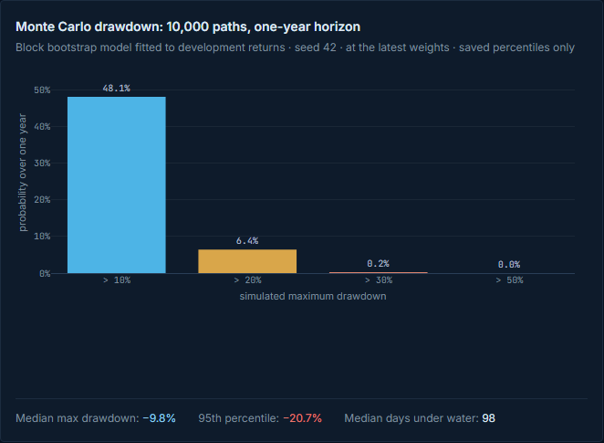

# Stock Return Predictor

Predicting next-day returns of 11 large US equities with a random forest, and
measuring whether any edge survives transaction costs, the number of strategies
tried, and a one-time out-of-sample test.


---

## The finding

**There is no convincing evidence of an edge.** Next-day equity direction in
this universe is close to unpredictable. The edge the model found is smaller
than the cost of trading it. Every strategy selected on development data fails
the deflated Sharpe luck threshold. A holdout opened only once, under a rule
fixed in advance, confirmed this.

**The forecasts carry almost no information.** Over 2005–2019, scored out of
fold:

- the random forest ranked tomorrow's returns with an information coefficient of
  **+0.0059**;
- it called the direction right on **51.78%** of days, against **51.75%** for
  simply predicting "up" every day.

The edge over that naive rule is three hundredths of a percentage point.

**No strategy built on those forecasts beat simply holding the same eleven
stocks in equal weights.** The table covers 2005–2019, as a mean over 5
combinatorial purged cross-validation paths. "Beat" means a higher Sharpe ratio,
counted over 1,000 block-bootstrap resamples.

| Strategy | Gross Sharpe | Net Sharpe | Max drawdown | Beat equal-weight hold | Beat SPY |
| --- | ---: | ---: | ---: | ---: | ---: |
| ML long/short (daily) | 0.82 | 0.76 | −34.5% | 25.7% | 93.8% |
| ML long only (daily) | 0.78 | 0.75 | −40.1% | 20.2% | 97.3% |
| ML thresholded (trade only past costs) | 0.72 | 0.70 | −39.2% | 16.5% | 85.3% |
| Momentum 12-1 (monthly) | 0.10 | 0.05 | −35.4% | 0.3% | 4.7% |
| Pairs mean reversion | −0.10 | −0.17 | −30.4% | 0.0% | 1.6% |
| *SPY, buy and hold* | *0.56* | *0.56* | *−55.2%* | *1.3%* | — |
| *Equal-weight hold, 11 stocks* | *0.86* | *0.86* | *−47.8%* | — | *98.7%* |

**The holdout was opened once and gave the same answer.** The predeclared
primary strategy was minimum-variance allocation, the best development candidate.
It was judged once on 2020–2024, data no model, parameter or choice had seen.
The decision rule was written, hashed and committed before the holdout was
opened.

| Holdout, 2020-01-03 → 2024-12-30 | Observed | Required | Met |
| --- | ---: | ---: | :---: |
| Net Sharpe, minimum variance | 0.54 | — | — |
| Net Sharpe, equal-weight hold | 0.80 | — | — |
| Deflated Sharpe ratio, N = 98 trials | 0.149 | > 0.95 | No |
| Net Sharpe difference, 95% paired block-bootstrap interval | −0.26 [−0.74, +0.14] | entirely > 0 | No |

**A negative result is the expected outcome of a careful process.** Daily
returns of liquid large-cap stocks are about as close to efficient as markets
get. A portfolio project that claims a profitable daily equity strategy usually
has a leak, a missing cost, or a search it did not count. This project:

- built the guards against those three failures first;
- counted every configuration it tried;
- charged for that search;
- spent its holdout exactly once.

The project's value is the machinery that makes a negative answer trustworthy.

Full reports:

- the development report, [`reports/research_report.md`](reports/research_report.md);
- the holdout report,
  [`reports/results/holdout/attempt-1/report.md`](reports/results/holdout/attempt-1/report.md);
- the protocol that governed the holdout,
  [`reports/methodology/holdout_protocol.md`](reports/methodology/holdout_protocol.md).

---

## Contents

1. [Results](#results)
2. [Features](#features)
3. [Tech stack](#tech-stack)
4. [Architecture](#architecture)
5. [Project structure](#project-structure)
6. [Installation and setup](#installation-and-setup)
7. [Usage](#usage)
8. [Screenshots](#screenshots)
9. [Engineering decisions](#engineering-decisions)
10. [Limitations](#limitations)
11. [Future improvements](#future-improvements)
12. [References](#references)
13. [Notes](#notes)

---

## Results

Every number below is read from a committed file under `reports/results/`. Each
one can be traced to the run, commit and configuration that produced it.

### Data and setup

| Item | Value |
| --- | --- |
| Universe | SPY, AAPL, MSFT, JNJ, JPM, XOM, PG, KO, WMT, GE, INTC |
| History | 2005-01-03 → 2024-12-30, 5,032 daily bars per ticker, 55,352 bars in all |
| Development period | 2005–2019 (every model, feature, parameter and selection) |
| Holdout | 2020-01-01 → 2024-12-31, opened once on 2026-10-26 |
| Target | Next-day return (fixed horizon, 1 day), pooled across tickers |
| Features | 19: lagged returns, moving-average gaps, volatility, RSI, momentum, distance from high, volume, volatility ratio, and a fractionally differentiated price |
| Model | Random forest regression, 300 trees, depth 6, minimum 50 rows per leaf |
| Validation | Combinatorial purged cross-validation: 6 groups, 2 test groups, 15 splits, 5 full paths, 36-day embargo |
| Costs | 2 bps commission + 3 bps slippage per side (10 bps round trip), 50 bps a year to borrow shorts, one-bar execution delay |

### Forecast quality, out of fold, against naive baselines

Over 39,985 labelled rows, each predicted only by models that never saw it:

| Forecast | Pooled IC | Within-date rank IC | Hit rate | Edge over always-up |
| --- | ---: | ---: | ---: | ---: |
| **Random forest** | **+0.0059** | **+0.0047** (t = 0.78) | **51.78%** | **+0.03 pp** |
| Always up | — | — | 51.75% | 0 |
| Random | +0.0049 | +0.0022 | 50.35% | −1.41 pp |
| Last day's sign | −0.0277 | −0.0047 | 48.76% | −3.00 pp |
| Reverse last day's sign | +0.0277 | +0.0047 | 51.24% | −0.51 pp |

What the table shows:

- **Across paths.** The pooled IC was positive on 4 of 5 paths and ranged from
  −0.0016 to +0.0106.
- **Within each day.** The rank IC is not distinguishable from zero.
- **Errors.** The random forest's mean absolute error is 0.0102 and its root mean
  squared error 0.0160. Its out-of-fold R² is 0.0023.
- **No error baseline.** The direction rules forecast a sign, not a size, so they
  have no error figures. No zero-return forecast was saved to compare against.
- **Reversal.** Simply reversing yesterday's sign matches the forest's ranking
  quality but has a worse hit rate.

### Strategy comparison, gross and net

Development, mean over the 5 CPCV paths. The interval is the 95% paired
block-bootstrap interval for the net Sharpe difference against equal-weight
hold.

| Strategy | Gross Sharpe | Net Sharpe | Net minus equal weight [95%] | Turnover / yr | Cost / yr | Net exposure |
| --- | ---: | ---: | ---: | ---: | ---: | ---: |
| ML long/short | 0.817 | 0.759 | −0.10 [−0.36, +0.16] | 17.7× | 0.9% | 0.92 |
| ML long only | 0.775 | 0.748 | −0.11 [−0.33, +0.10] | 8.9× | 0.4% | 0.96 |
| ML thresholded | 0.717 | 0.701 | −0.16 [−0.44, +0.12] | 3.3× | 0.2% | 0.70 |
| Momentum 12-1 | 0.100 | 0.049 | −0.81 [−1.39, −0.28] | 5.7× | 0.5% | 0.09 |
| Pairs (portfolio of selected pairs) | −0.101 | −0.172 | −1.03 [−1.75, −0.37] | 6.9× | 0.4% | −0.03 |
| SPY buy and hold | 0.560 | 0.560 | −0.30 [−0.56, −0.03] | 0.1× | 0.0% | 1.00 |
| Equal-weight hold | 0.857 | 0.857 | reference | 0.1× | 0.0% | 1.00 |

What the table shows:

- **No strategy beats equal-weight hold.** None of the intervals lies above zero.
- **Momentum and pairs are worse.** Momentum, the combined pairs book and 11 of
  the 13 individual pairs are distinguishably worse than holding.
- **The ML books are mostly market exposure.** The ML long/short book was net
  long 92% of its capital on average, so most of its return is market exposure
  rather than forecasting skill.

The full table, with every individual pair and a diagnostic same-close variant,
is in [`reports/research_report.md`](reports/research_report.md).

### Portfolio allocations

These are monthly rebalanced, long only, and walk-forward from trailing windows
(2006-01-31 → 2019-12-31).

| Allocation | Net Sharpe | Minus equal weight [95%] | Resamples beating equal weight | Max drawdown | Turnover / yr |
| --- | ---: | ---: | ---: | ---: | ---: |
| Minimum variance | 0.785 | +0.06 [−0.21, +0.32] | 70.8% | −33.1% | 1.7× |
| Risk parity | 0.749 | +0.03 [−0.03, +0.08] | 82.2% | −42.0% | 0.6× |
| Inverse volatility | 0.741 | +0.02 [−0.04, +0.08] | 71.8% | −42.5% | 1.1× |
| Equal weight (monthly) | 0.724 | reference | — | −46.0% | 0.5× |
| Maximum Sharpe | 0.604 | −0.12 [−0.41, +0.14] | 17.6% | −40.2% | 5.7× |

- **Most diversified is not most profitable.** The optimised maximum-Sharpe
  portfolio did worst. It is the allocation that leans hardest on noisy estimates
  of expected returns.
- **The efficient frontier did not deliver what it promised.** Fitted on
  2005–2012, the maximum-Sharpe portfolio expected a 20.9% annual return and
  realised 15.5% over 2012–2019. Equal weight realised the highest Sharpe of the
  three frontier portfolios: 1.10, against 1.07 for minimum variance and 0.99 for
  maximum Sharpe.

### Deflated Sharpe ratio: the number of trials, charged

The deflated Sharpe ratio (DSR) asks how good the best of N strategies would look
if none of them had any skill. It then asks whether the selected strategy beats
that.

| Item | Value |
| --- | --- |
| Trials counted, N | **98** distinct configurations: 56 from the pipeline, 42 from the exploratory notebooks |
| Variance of Sharpe ratios across candidates, V[SR] | 0.1582 a year (the largest pre-registered option) |
| Luck threshold: expected best annual Sharpe of 98 unskilled trials | **1.004** |
| Best development candidate | Minimum variance, annual Sharpe 0.785 → **DSR 0.207** |
| Best ML strategy (ML long/short, against its own scenario's threshold of 0.865) | Sharpe 0.759 → **DSR 0.343** |
| Same candidate in the holdout | Sharpe 0.537 → **DSR 0.149** |
| Range across every pre-registered count and variance scenario (24 to 98 trials) | DSR 0.207 to 0.638; none reaches 0.95 |
| Trials at which the DSR first falls below 0.95 | **4** |

The headline counting rules were fixed before the result was known, in
[`reports/methodology/trial_accounting.md`](reports/methodology/trial_accounting.md).
They are deliberately conservative.

The trials are correlated: they share one forecast and the same eleven stocks.
Two estimates of the effective number of independent trials put it at 49 to 56.
That would raise the DSR to 0.30–0.33, still far below 0.95.

The DSR is the probability, under its assumptions, that the true Sharpe ratio
exceeded the luck threshold. **It is not a probability of future profit.**

### Monte Carlo: the result as a probability

A single backtest is one draw of history. Each strategy's daily returns were
resampled 1,000 times in 21-day blocks, which keeps volatility clusters intact.
The question asked of each resample was how often the strategy came out ahead.

| Strategy | Median Sharpe [95% interval] | Median max drawdown | Beat equal-weight hold | Beat SPY |
| --- | --- | ---: | ---: | ---: |
| ML long/short | 0.76 [0.31, 1.26] | −26.0% | 25.7% | 93.8% |
| ML long only | 0.74 [0.31, 1.23] | −26.9% | 20.2% | 97.3% |
| ML thresholded | 0.69 [0.25, 1.18] | −24.6% | 16.5% | 85.3% |
| Momentum 12-1 | 0.05 [−0.42, 0.50] | −33.3% | 0.3% | 4.7% |
| Pairs | −0.15 [−0.75, 0.35] | −25.6% | 0.0% | 1.6% |

- **Beating SPY is easy here.** The ML long-only book beat SPY in 97.3% of
  resamples, because the 11 survivors themselves beat SPY.
- **Equal-weight hold is the fair test.** Against holding those same stocks it
  won in only 20.2%.
- **The block length does not matter.** With 10- or 42-day blocks the ML
  long/short book's share stays between 24.0% and 25.7%.

For the portfolio, a forward simulation of 10,000 one-year paths at the latest
minimum-variance weights gives:

- a 95% VaR of 9.6% and a 99% VaR of 17.5%;
- a median maximum drawdown of 9.8%;
- a 48.1% chance of a drawdown beyond 10% within the year.

### Regimes: where the model did best

Days were split into low, normal and high volatility using each day's trailing
volatility against its own past, so no future information enters the label.

| Regime | Days | IC (paths positive) | Equal-weight hold Sharpe | ML long/short Sharpe | ML long/short minus hold [95%] |
| --- | ---: | --- | ---: | ---: | --- |
| Low volatility | 1,318 | +0.0134 (5 of 5) | 1.12 | 0.75 | −0.36 [−0.87, +0.13] |
| Normal | 1,013 | −0.0120 (1 of 5) | 1.23 | 1.08 | −0.15 [−0.79, +0.52] |
| High volatility | 1,170 | +0.0094 (4 of 5) | 0.61 | 0.69 | **+0.08 [−0.29, +0.46]** |

- **High volatility is the one regime where the ML books came out ahead.**
  Long/short was ahead in 57.5% of resamples and long-only (+0.05) in 61.9%.
- **That is not an edge.** The intervals span zero comfortably. One favourable
  regime out of three, found after looking, is the kind of result the deflated
  Sharpe exists to discount.

### Holdout, every declared book

Only the primary entered the decision; the rest are descriptive and were
declared before the holdout opened.

| Book | Role | Gross Sharpe | Net Sharpe | Max drawdown | Turnover / yr |
| --- | --- | ---: | ---: | ---: | ---: |
| Minimum variance | **primary** | 0.54 | **0.54** | −25.4% | 2.0× |
| Maximum Sharpe | secondary | 0.99 | 0.98 | −30.4% | 5.0× |
| ML long only | secondary | 0.90 | 0.83 | −25.5% | 19.7× |
| Risk parity | secondary | 0.79 | 0.79 | −29.8% | 0.8× |
| Inverse volatility | secondary | 0.78 | 0.77 | −29.5% | 1.3× |
| ML long/short | secondary | 0.88 | 0.75 | −19.6% | 39.2× |
| Pairs | secondary | 0.46 | 0.41 | −23.4% | 11.8× |
| ML thresholded | secondary | 0.37 | 0.33 | −20.1% | 8.1× |
| Momentum 12-1 | secondary | 0.26 | 0.23 | −34.8% | 4.9× |
| Equal-weight hold | benchmark | 0.80 | 0.80 | −31.4% | 0.2× |
| SPY buy and hold | benchmark | 0.75 | 0.75 | −33.7% | 0.2× |

Two results show why the rule had to be fixed in advance:

- **Costs flip the ML long/short result.** Gross, it beat equal-weight hold
  (0.88 against 0.80). Net, it did not (0.75): turnover of 39× a year cost it 2%
  a year.
- **The best holdout book was not the declared one.** Maximum Sharpe scored best
  in the holdout, after doing worst in development. Choosing it now, after
  seeing the holdout, would be exactly the selection the protocol forbids.

---

## Features

**Data pipeline**

- Downloads from Yahoo Finance with a Stooq fallback, cached once as parquet. The
  committed cache makes every result reproducible offline.
- Cleaning:
  - flags moves beyond ±50% (unadjusted splits) instead of silently dropping them;
  - forward-fills gaps of at most 3 days and flags them;
  - drops zero-volume bars.
- A fixed 11-ticker universe, with its survivorship bias stated in the
  configuration rather than hidden.

**Feature engineering**

- 19 features: lagged returns (1–21 days), price relative to 5/10/21/63-day
  averages, 10/21/63-day volatility, RSI, 63-day momentum, distance from the
  63-day high, relative volume, and a short-over-long volatility ratio.
- Fractional differentiation: the smallest order d that makes log prices pass an
  ADF test. It makes prices stationary while keeping their memory.
- A look-ahead assertion that rebuilds the matrix on a truncated history and
  requires every shared row to be identical.

**Labelling**

- Fixed-horizon forward return, used as a regression target.
- Fixed-horizon sign, with an optional dead zone, used as a classification
  target.
- Triple barrier: profit-take, stop-loss and time limit, scaled by volatility.
- Sample weights from label uniqueness and concurrency, with optional time decay.

**Validation**

- Purged k-fold with an embargo counted in trading dates.
- Combinatorial purged cross-validation (CPCV), which turns 15 splits into 5
  complete backtest paths.
- Leakage checks that raise rather than warn: no shared dates, no training row
  inside a test block's feature window, no overlapping labels.
- Metrics that do not flatter:
  - pooled and within-date rank IC with t-statistics;
  - hit rate against always-up;
  - MAE, RMSE and R²;
  - IC by path, by year and by regime.

**Models**

- Naive baselines: always up, random, last sign, reverse last sign, buy and hold.
- One estimator wrapper for random forest and LightGBM, regression or
  classification, with permutation importance across folds.
- An LSTM sequence model, implemented and unit-tested (see the engineering
  decisions).
- Persistence that saves each model with its metadata: parameters, feature list,
  training window and row count, library versions, git commit and config hash.

**Strategies and backtesting**

- Four strategy families:
  - ML long/short, long only, and thresholded (trade only when the forecast pays
    for the round trip);
  - 12-1 cross-sectional momentum;
  - Engle-Granger cointegrated pairs.
- A vectorised engine with explicit timing: one-bar execution delay, weights that
  drift between trades, leverage limits.
- A cost model charged from the first run: commission, slippage, short borrow, and
  breakeven cost.
- Performance:
  - Sharpe, Sortino and Calmar;
  - drawdown and time underwater;
  - turnover, exposure, and the Sharpe standard error.

**Portfolio and risk**

- Allocations: equal weight, inverse volatility, risk parity, minimum variance and
  maximum Sharpe. They use Ledoit-Wolf shrunk covariance and shrunk expected
  returns, and rebalance monthly from trailing windows.
- An efficient frontier fitted on one half of the development period and scored
  on the other half.
- Risk measures:
  - risk contributions, the diversification ratio and the effective number of
    assets;
  - VaR and CVaR from normal, Student t and bootstrap models;
  - drawdown and ruin probabilities;
  - historical stress replays: 2008, 2011, 2015 and 2018.

**Statistical evaluation**

- Monte Carlo resampling: IID, moving block and stationary bootstrap, with a
  block-length sensitivity check.
- Paired block-bootstrap confidence intervals for every Sharpe difference.
- Probabilistic and deflated Sharpe ratios, the minimum track record length, and
  the DSR under every pre-registered trial count.

**Experiment tracking**

- An append-only trial log of every configuration ever run: 187 executions.
- Fingerprints, code versions and config hashes for every trial.
- MLflow runs mirroring the log.
- A frozen, hashed holdout protocol: a declaration, a preflight check, an attempt
  record, and output hashes.

**Reporting and dashboard**

- A research report generated from saved results, and a results notebook executed
  from a clean kernel.
- **QuantLab**, a read-only Dash dashboard of seven pages over the saved results.

---

## Tech stack

Python **3.12**, with **[uv](https://docs.astral.sh/uv/)** for the environment
and lock file. Dependencies live in `pyproject.toml` and `uv.lock`; there is no
`requirements.txt`.

| Purpose | Libraries | Used for |
| --- | --- | --- |
| Data | pandas, NumPy, PyArrow, yfinance, pandas-datareader | Frames, arrays, the parquet cache, Yahoo and Stooq downloads |
| Modelling | scikit-learn, LightGBM, PyTorch (CPU) | Random forest and Ledoit-Wolf; gradient boosting; the LSTM |
| Statistics and optimisation | SciPy | Rank correlation, distributions, constrained portfolio optimisation (SLSQP) |
| Backtesting and evaluation | Hand-rolled (`src/backtest`, `src/evaluation`) | Engine, costs, bootstrap, PSR and DSR |
| Visualisation | Matplotlib, Plotly, Dash | Report figures; the interactive dashboard |
| Tracking | MLflow, CSV trial log | Run tracking; the trial log is the record of truth |
| Configuration | PyYAML, joblib | Typed config with validation guards; model bundles |
| Testing and linting | pytest, Ruff, statsmodels (tests only), GitHub Actions | 754 tests, lint and format checks in CI |
| Notebooks | JupyterLab, ipykernel | Exploration and the executed results notebook |

**Written by hand rather than imported, on purpose:**

- **ADF test and Engle-Granger cointegration** (`src/features/fracdiff.py`,
  `src/backtest/pairs.py`). The regression behind the statistic is visible, lag
  order follows Schwert's rule, and the tests check the result against
  statsmodels.
- **Fractional differentiation.** The weight recursion and the search for the
  minimum d are the point of the exercise, so they are written out.
- **Purged CV and CPCV.** Leakage control is the core of the project, and
  library splitters do not purge on label end times or embargo in trading days.
- **Backtest engine and cost model.** Timing is where backtests usually go wrong.
  One small engine with one documented timing rule, and a test showing that an
  always-long book equals buy and hold exactly, is easier to trust than a
  framework.
- **PSR, DSR and the bootstraps.** The trial accounting and the variance
  scenarios had to be explicit and auditable.

---

## Architecture



Red hexagons mark the look-ahead guards. Amber marks the single point where
transaction costs are charged.

**One design rule shapes everything: nothing computed at time `t` may use data
from after `t`.** The rule is enforced by assertions in the pipeline, which fail
the run, rather than left to careful coding:

- **Features.** `assert_no_lookahead` rebuilds the feature matrix on a history cut
  at 80% and requires every shared row to be identical. Any feature that peeked
  forward would change when the future is removed.
- **Validation.** The splitter raises `LeakageError` if a date sits on both
  sides, if a label crosses into a test block, or if a training row falls inside
  the embargo after one.
- **Holdout boundary.** The research pipeline refuses any label dated or resolved
  on or after 2020-01-01.
- **Trade timing.** The engine holds the position chosen at the close of `t` from
  `t` to `t+1`. It therefore earns the return of `t+1`, never `t`.
- **Holdout preflight.** The holdout runner refuses to start unless all of these
  hold:
  - the tree is clean;
  - the freeze and declaration hashes match;
  - the first 175 rows of the trial log are byte-identical to the frozen copy.

---

## Project structure

```text
stock-return-predictor/
├── config/
│   ├── config.yaml                 universe, dates, features, CV, model, costs, strategies, portfolio
│   └── logging.yaml                logging format and handlers
├── data/                           committed so every result reproduces offline
│   ├── 01-raw/                     cached price pulls, one parquet per ticker
│   ├── 02-bars/                    cleaned, adjusted daily panel
│   └── 03-features/                the feature matrix
├── src/
│   ├── config.py                   typed, validated settings (raises on bad values)
│   ├── logger.py                   logging setup; shape and date range of every frame
│   ├── data/                       loaders (Yahoo, Stooq fallback, cache), universe, cleaning
│   ├── features/                   technical features, fracdiff + hand-rolled ADF, matrix build
│   ├── labelling/                  fixed horizon, triple barrier, uniqueness sample weights
│   ├── validation/                 purged k-fold with embargo, CPCV, IC and hit-rate metrics
│   ├── models/                     baselines, RF/LightGBM wrapper, LSTM, persistence with metadata
│   ├── backtest/                   strategy rules, cost model, engine, performance, momentum, pairs
│   ├── portfolio/                  allocations, frontier optimisation, risk contributions
│   ├── evaluation/                 trial log, PSR/DSR, Monte Carlo, forward risk, trial scenarios
│   ├── tracking/                   MLflow runs mirroring the trial log
│   ├── reporting/                  figures, stationarity table, the research report
│   └── pipelines/                  research, evaluate, portfolio, diagnostics, holdout
├── entrypoint/                     command-line entry points: fetch, research, evaluate, holdout
├── dashboard/                      QuantLab, the read-only Dash app
│   ├── app.py                      shell, navigation, global controls, export
│   ├── data.py                     loads saved results from disk, cached
│   ├── theme.py · charts.py        design tokens, components, chart builders
│   ├── assets/                     stylesheet and bundled fonts (no network needed)
│   └── pages/                      overview, market data, features, model, backtest, portfolio, experiments
├── notebooks/
│   ├── 01_data_quality.ipynb       what the raw data looks like
│   ├── 02_stationarity.ipynb       ADF across d, choosing the fracdiff order
│   ├── 03_feature_research.ipynb   IC, leak checks, importance stability
│   ├── 04_backtest.ipynb           costs, position rules, bootstrap, PSR
│   └── 05_results.ipynb            final results from the production pipeline
├── reports/
│   ├── research_report.md          development findings, generated from saved results
│   ├── trial_log.csv               every configuration ever run (append-only)
│   ├── figures/                    every figure, regenerated from data, not screenshotted
│   ├── methodology/                holdout protocol, trial accounting, verification notes, reconciliation
│   └── results/                    research, evaluation, portfolio, holdout, frozen inputs
├── tests/                          754 tests across 39 files, synthetic data unless stated
├── models/                         trained bundles (gitignored; rebuilt by the pipeline)
├── docs/images/                    README screenshots
├── .github/workflows/test.yml      CI: ruff check, ruff format check, pytest
├── pyproject.toml                  dependencies, ruff and pytest settings (uv managed)
├── uv.lock                         exact resolved versions
├── Makefile                        every pipeline step as a target
└── task.md                         the implementation plan this project followed
```

---

## Installation and setup

**Requirements:** Python 3.12 and [uv](https://docs.astral.sh/uv/getting-started/installation/).
Git is needed for the holdout tooling, which checks commits and hashes.

```bash
git clone <repository-url>
cd stock-return-predictor
uv sync --locked          # create .venv and install exactly what uv.lock pins
```

Things worth knowing:

- **No `requirements.txt`.** Dependencies are declared in `pyproject.toml` and
  pinned in `uv.lock`. `uv sync` installs the development tools too: pytest,
  Ruff and JupyterLab. Add `--no-dev` to leave them out.
- **The README must exist before `uv sync` will run.** `pyproject.toml` declares
  `readme = "README.md"`, and the project is built with hatchling, which checks
  that file at build time. If it is missing, `uv sync` fails with a build error
  whose message does not make the cause obvious.
- **PyTorch comes from the CPU-only index.** It is configured in `pyproject.toml`
  to keep the download small; no GPU is needed.
- **No data download is needed.** Prices, the clean panel, the features and every
  result are committed. You can read the reports, run the tests and open the
  dashboard straight after installing.

---

## Usage

The targets in the order you would run them, and what each one produces:

| Step | `make` | Plain command (Windows has no `make` by default) | Produces |
| --- | --- | --- | --- |
| Install | `make install` | `uv sync --locked` | `.venv/` from the lock file |
| Fetch data | `make fetch` | `uv run python entrypoint/fetch.py` | `data/01-raw/*.parquet` (skipped when cached) |
| Exploratory figures | `make eda` | `uv run python -m src.reporting.figures` then `uv run python -m src.reporting.stationarity` | `reports/figures/eda_*.png`, `reports/results/stationarity.csv` |
| Research run | `make research` | `uv run python entrypoint/research.py` | `reports/results/research/…`: importance, IC by path, year and regime, out-of-fold predictions; one trial-log row |
| Strategy evaluation | `make evaluate` | `uv run python entrypoint/evaluate.py` | `reports/results/evaluation/`: CPCV backtests, comparison, Monte Carlo, regimes; trial-log rows |
| Portfolio and risk | `make portfolio` | `uv run python -m src.pipelines.portfolio` | `reports/results/portfolio/`: allocations, frontier, VaR/CVaR, stress |
| Report | `make report` | `uv run python -m src.reporting.report` | `reports/research_report.md` |
| Cost reconciliation | `make reconcile` | `uv run python reports/methodology/cost_reconciliation.py` | `reports/results/reconciliation/` |
| Results notebook | `make results` | `uv run jupyter nbconvert --to notebook --execute --inplace notebooks/05_results.ipynb` | the executed notebook |
| Tests | `make test` | `uv run pytest` | 754 tests |
| Lint | `make lint` | `uv run ruff check .` and `uv run ruff format --check .` | style and format check |
| CI equivalent | `make ci` | lint, format check, `uv run pytest -q` | what GitHub Actions runs |
| Dashboard | `make dashboard` | `uv run python -m dashboard.app` | http://127.0.0.1:8050 |
| Everything | `make all` | the development steps above, in order | the full development pipeline |

`make help` lists every target.

The dashboard takes options:

```bash
uv run python -m dashboard.app --port 8060    # another port
uv run python -m dashboard.app --debug        # Dash dev tools and hot reload
```

> **The holdout has already been run, once.** `make holdout-check` (the
> preflight) and `make holdout` (the one-time run) exist so the procedure can be
> audited. Running them again would not reopen anything: the attempt is
> recorded and hashed.
>
> **Re-running the development pipeline after the holdout will make the
> preflight fail, by design.** `make research`, `evaluate` and `portfolio` fit
> models and append trials. Only holdout rows may follow the frozen 175-row
> trial-log prefix. The committed results are the ones the conclusion rests on.

---

## Screenshots

The QuantLab dashboard reads only saved files. It never fits a model, reruns a
backtest or touches the holdout.

**Overview.** The research question, the holdout verdict with its decision table,
the known biases, and the headline metrics:



**Backtesting.** Costs in basis points, gross beside net, and growth of 100
against equal-weight hold on the 2020–2024 holdout:



**Efficient frontier.** The curve fitted on 2005–2012 beside where the same
portfolios actually landed in 2012–2019:



**Monte Carlo drawdown.** The probability of each one-year drawdown depth for the
minimum-variance portfolio, from 10,000 block-bootstrap paths:



The pages, and the questions they answer:

| Page | Question it answers |
| --- | --- |
| Overview | What was asked, what the holdout decided, and how far to trust it |
| Market Data & EDA | Prices, return distribution, volatility, autocorrelation, correlation, stationarity |
| Feature & Signal | Importance and its stability across folds, redundancy, IC over time and by regime, every test run |
| Model Performance | The random forest against four baselines, by path and by year |
| Backtesting | Gross against net, costs, growth, drawdown, calendar years, paired intervals |
| Portfolio & Risk | Weight against risk share, the frontier in and out of sample, VaR/CVaR, stress |
| Experiments Registry | The trial log, the frozen N and luck threshold, file hashes, MLflow runs |

The static figures behind the reports are in [`reports/figures/`](reports/figures/).

---

## Engineering decisions

Each decision states the choice, the alternative, and why this one won. Some were
settled by running both options; those give both numbers. Others were settled by
argument, and say so.

### Random forest rather than an LSTM

- **Choice:** a pooled random forest: 300 shallow trees (depth 6) with at least
  50 rows per leaf, predicting next-day return.
- **Alternative:** an LSTM over 21-day sequences.
- **Why:**
  - There are 5,032 bars per ticker, and 39,985 labelled rows once all tickers
    are pooled and the warm-up is dropped. That is very little data for a
    recurrent network.
  - Daily returns have almost no autocorrelation for a sequence model to exploit.
  - A heavily regularised forest is hard to overfit and gives permutation
    importances that can be checked fold by fold.
- **Measured or argued:** argued. The LSTM is implemented and tested in
  `src/models/sequence.py`, and LightGBM is configured, but neither was run in the
  reported pipeline. They therefore do not appear in the trial count.

### Fractional differentiation rather than prices or returns

- **Choice:** difference log prices by the smallest order d that passes an ADF
  test at 95%.
- **Alternatives:** raw prices, or first differences (returns).
- **Why, measured** (on the full-sample stationarity table,
  `reports/results/stationarity.csv`):
  - **Prices are not stationary.** No ticker's log price is: ADF statistics
    range from −1.70 to +1.36, against a critical value of −2.86.
  - **Returns are stationary but memoryless.** Every ticker's returns pass
    easily, with statistics from −11.5 to −13.4. But their correlation with the
    price series they came from is only −0.004 to 0.034.
  - **The minimum d keeps the memory.** Each ticker's minimum d lies between 0.3
    and 0.7, and the series it produces keeps a correlation of 0.68 to 0.89 with
    the price.
- **Choosing one d:** the pipeline uses d = 0.60, the largest minimum d
  estimated on development data alone. One order then makes every ticker
  stationary without looking at the holdout.
- **Did it help?** The fractionally differentiated price was the second most
  important of the 19 features. The absolute importances are tiny, which is
  consistent with the forecast results.

### Purging and an embargo rather than a plain chronological split

- **Choice:** purge training labels that overlap a test block, and embargo 36
  trading dates after each test block.
- **Alternative:** a plain chronological split.
- **Why:**
  - **Purging handles overlapping labels.** With triple-barrier labels, outcomes
    overlap and purging is mandatory. With one-day labels nothing overlaps, so
    purging removes nothing.
  - **The embargo handles overlapping features.** The features still overlap:
    a 21-day volatility computed just after a test block is built from
    test-period prices. The 36-day embargo covers every short-memory feature.
    Longer 63-day windows stay similar for longer than any gap could cover, and
    the rows before each block are just as similar and never embargoed.
- **Measured, by rerunning with embargoes of 0, 36, 63 and 139 days:**

  | Embargo | Mean training rows | Pooled IC | Hit rate |
  | ---: | ---: | ---: | ---: |
  | 0 days | 26,657 | +0.0027 | 51.78% |
  | 36 days (used) | 26,129 | +0.0059 | 51.78% |
  | 63 days | 25,733 | +0.0058 | 51.81% |
  | 139 days | 24,618 | +0.0065 | 51.76% |

  The paired difference between 0 and 36 days was −0.0024 (t = −1.30), not
  distinguishable. In this data the leakage the embargo blocks was too small to
  measure. It is kept because it is correct in principle and costs only 2% of the
  training rows.

### CPCV rather than a single walk-forward

- **Choice:** combinatorial purged cross-validation with 6 groups and 2 test
  groups. That gives 15 train/test splits, recombined into 5 complete,
  non-overlapping backtest paths.
- **Alternative:** one walk-forward pass.
- **Why, measured:**
  - **One walk-forward is one draw of history, reported as if it were the
    answer.** Across the 5 CPCV paths the pooled IC ranged from −0.0016 to
    +0.0106, and was positive on only 4 of them.
  - **Strategy results vary by path too.** The ML long/short net Sharpe had a
    standard deviation of 0.086 across paths.
  - **A single path could report anything in that range.** Five paths show the
    spread, and provide the variance of Sharpe ratios that the deflated Sharpe
    needs.

### Block bootstrap with 21-day blocks rather than IID resampling

- **Choice:** resample returns in blocks of about a trading month.
- **Alternative:** resample single days independently.
- **Why, measured:** volatility clusters, and calm and turbulent days come in runs.
  The autocorrelation of squared daily returns measures this clustering:

  | Series | Autocorrelation of squared returns |
  | --- | ---: |
  | Original returns | 0.167 |
  | Block bootstrap, 21 days | 0.184 |
  | Stationary bootstrap | 0.176 |
  | IID bootstrap | 0.0006 |

  IID resampling destroys the clustering completely, which understates drawdowns
  and the chance of long losing streaks. The block length itself barely matters.
  With 10-, 21- and 42-day blocks, the share of resamples in which ML long/short
  beat equal-weight hold was 24.0%, 25.7% and 25.2%.

### Costs built before the backtest engine, not added afterwards

- **Choice:** the cost model existed before the engine, and every backtest has
  been net of costs since its first run.
- **Alternative:** build the engine, then subtract costs.
- **Why, measured:** turnover decides whether a daily strategy survives.
  `reports/methodology/cost_reconciliation.py` replays notebook 4's daily
  long/short rule on SPY over the development years, changing one thing at a
  time. The last two steps use the same sign rule, engine, one-bar delay and
  costs. What differs is the forecasts, and the notebook's history, which starts
  in 2008:

  | Same rule on SPY | Turnover / yr | Cost / yr | Gross Sharpe | Net Sharpe |
  | --- | ---: | ---: | ---: | ---: |
  | Notebook 4's forecasts | 130× | 6.7% | 0.53 | 0.19 |
  | Pipeline forecasts | 12× | 0.6% | 0.54 | 0.50 |

  The gross Sharpe is almost identical. The notebook's forecasts flipped sign so
  often that costs took two thirds of it. A strategy that
  looks good gross and dies net was never a strategy, so no gross-only number was
  ever allowed to exist. The engine's own correctness rests on one test: an
  always-long book must reproduce buy and hold exactly.

### The trial log built before the first model

- **Choice:** an append-only log of every configuration, fingerprinted and tied to
  a code version, built before any model was fitted in the pipeline.
- **Alternative:** reconstruct the search afterwards.
- **Why, measured:** the deflated Sharpe depends on N, and N cannot be
  reconstructed after the fact. This project learned it the hard way:
  - the 42 notebook experiments ran before the log existed;
  - their code and settings are not recoverable;
  - they enter N from their saved outputs only.

  The count matters. The DSR of the same strategy is 0.497 at 24 trials and 0.207
  at 98. The log now holds 187 executions, and its first 175 rows were frozen and
  hashed before the holdout.

### Monthly rebalancing for momentum, daily for the ML signal

- **Choice:** momentum and the allocations rebalance monthly. The ML strategies
  trade daily, because the forecast is for one day.
- **Why:**
  - A 12-month signal changes slowly, so trading it daily would pay costs for
    noise.
  - A one-day forecast is stale after a day.
- **What it does to costs:**
  - Momentum turned over 5.7× a year, costing 0.5% a year.
  - ML long/short turned over 17.7× a year in development (0.9% a year), and 39×
    in the holdout (2.0% a year).
  - The thresholded ML variant trades only when the forecast exceeds one round
    trip. That cut turnover to 3.3× a year, but also cut the Sharpe.
- **Costs are not always what decides it.** For momentum the cost drag was small
  (0.05 of Sharpe); the signal simply had nothing to lose.

### Equal-weight hold as the benchmark, not SPY or the optimised portfolio

- **Choice:** hold the same 11 stocks in equal weights, and judge every strategy
  against that.
- **Alternatives:** SPY, or the optimised maximum-Sharpe portfolio.
- **Why, measured:**
  - **SPY is too easy.** The universe is 11 survivors, and holding them equally
    beat SPY in 98.7% of resamples. Against SPY, the ML long-only book "wins" in
    97.3% of resamples; against equal-weight hold of the same stocks, in 20.2%.
    Benchmarking against SPY would have credited the strategies with the
    universe's survivorship.
  - **The optimised portfolio is too noisy.** Its expected returns are the
    noisiest input in finance. Fitted on 2005–2012, the maximum-Sharpe portfolio
    expected 20.9% a year and delivered 15.5%. Equal weight had the higher
    realised Sharpe (1.10 against 0.99), consistent with DeMiguel, Garlappi and
    Uppal (2009).

### One predeclared primary for the holdout, judged once

- **Choice:** before opening 2020–2024, fix and commit:
  - one primary strategy;
  - the trial count N and the Sharpe variance V[SR];
  - the decision rule;
  - the hashes of all of these.
- **Alternative:** evaluate everything on the holdout and report the best.
- **Why:** the holdout's best book, maximum Sharpe at 0.98, was the development
  period's worst allocation. Picking it now would turn the holdout into one more
  trial, and spend the only untouched data on a selection.

---

## Limitations

Specific, with the size of each problem where it can be estimated.

- **Survivorship bias.**
  - The 11 tickers were chosen knowing they survived to 2024. Every long book is
    flattered, and equal weight most of all.
  - Published estimates of survivorship bias in equity backtests are commonly
    put at 1–4% of annual return. It was not measured here, and cannot be removed
    without a point-in-time constituent list.
- **Earlier exploration saw the holdout years.** The notebooks that shaped the
  features and the strategy families explored data through 2024. The pipeline
  never used post-2019 data before the holdout run, but the ideas behind it are
  not fully independent of that period.
- **One asset class, one market, one frequency.** These are US large caps, 11
  tickers and daily bars. There are no commodities, currencies or intraday data,
  and no smaller or less liquid names, where predictability is usually
  different.
- **Daily frequency is where costs bite hardest.** Weekly or monthly
  rebalancing of the same forecasts was not tested. It could change the
  cost-versus-edge balance and is the obvious next step.
- **Costs are an assumption, not a measurement.**
  - Trading costs are 5 bps per side: 2 commission and 3 slippage. That is
    reasonable for liquid US large caps, but they are not real fills.
  - Shorting is assumed always available, at a flat 50 bps a year. Real borrow
    availability and cost vary by name and by date.
- **No market impact model.** Position size is assumed not to move the price.
  That holds at small size and fails at scale.
- **The trial count is uncertain in both directions.**
  - **N may be too low.** Any exploratory work not recorded in the notebooks or
    the log is missing, so the luck threshold may still be too generous.
  - **N may be too high.** The trials are strongly correlated, so the effective
    number of independent trials is lower than 98. That makes the headline DSR
    conservative.
- **Adjusted prices carry a little forward information.** Yahoo back-adjusts
  earlier prices for later dividends and splits.
- **One model and one holdout path.** Every ML strategy shares one random forest's
  forecasts, so their results are not independent evidence. The holdout is a
  single five-year realisation. In it, the strategy return series were saved but
  the model forecasts were not, so there is no holdout IC.

---

## Future improvements

What would be done next, in order:

1. **Rebalance weekly and monthly.** The cost arithmetic says that is where a
   weak signal has the best chance of surviving.
2. **Add meta-labelling.** Let the primary model call the direction, and let a
   secondary model decide whether to take the bet and how large. That attacks
   the hit-rate problem directly instead of trading every forecast.
3. **Use a point-in-time universe.** Historical index constituents would remove
   survivorship bias.
4. **Add intraday data,** where the signal-to-noise ratio and the cost structure
   are both different.
5. **Walk the deflated Sharpe forward,** recomputing the luck threshold as trials
   accumulate, so every new idea is charged for the ones before it.
6. **Save forecasts during any future holdout,** so forecast quality can be
   judged out of sample alongside returns.

---

## References

- **López de Prado, M. (2018). "The 10 Reasons Most Machine Learning Funds Fail."**
  *Journal of Portfolio Management*, 44(6), 120–133. The project's checklist: the
  ten pitfalls are mapped onto modules, for example integer differentiation to
  `fracdiff.py` and leakage to `purged_cv.py`.
- **López de Prado, M. (2018). *Advances in Financial Machine Learning*.** Wiley.
  The source for fractional differentiation, triple-barrier labels, uniqueness
  sample weights, purged k-fold with embargo, and CPCV.
- **Hosking, J. R. M. (1981). "Fractional Differencing."** *Biometrika*, 68(1),
  165–176. The binomial weight recursion behind fractional differentiation.
- **Bailey, D. H., and López de Prado, M. (2012). "The Sharpe Ratio Efficient
  Frontier."** *Journal of Risk*, 15(2), 3–44. The probabilistic Sharpe ratio and
  the minimum track record length.
- **Bailey, D. H., and López de Prado, M. (2014). "The Deflated Sharpe Ratio:
  Correcting for Selection Bias, Backtest Overfitting, and Non-Normality."**
  *Journal of Portfolio Management*, 40(5), 94–107. The luck threshold for N
  trials, and the DSR used for every headline decision.
- **Harvey, C. R., Liu, Y., and Zhu, H. (2016). "… and the Cross-Section of
  Expected Returns."** *Review of Financial Studies*, 29(1), 5–68. Why multiple
  testing must be charged for.
- **Schwert, G. W. (1989). "Tests for Unit Roots: A Monte Carlo Investigation."**
  *Journal of Business & Economic Statistics*, 7(2), 147–159. The lag-order rule
  in the hand-rolled ADF test.
- **Engle, R. F., and Granger, C. W. J. (1987). "Co-Integration and Error
  Correction."** *Econometrica*, 55(2), 251–276. The cointegration test behind
  pairs selection.
- **MacKinnon, J. G. (2010). "Critical Values for Cointegration Tests."** Queen's
  Economics Department Working Paper 1227. Critical values for the ADF and
  Engle-Granger tests.
- **Gatev, E., Goetzmann, W. N., and Rouwenhorst, K. G. (2006). "Pairs Trading:
  Performance of a Relative-Value Arbitrage Rule."** *Review of Financial
  Studies*, 19(3), 797–827. The pairs strategy design.
- **Jegadeesh, N., and Titman, S. (1993). "Returns to Buying Winners and Selling
  Losers."** *Journal of Finance*, 48(1), 65–91. The 12-1 momentum signal.
- **Künsch, H. R. (1989). "The Jackknife and the Bootstrap for General Stationary
  Observations."** *Annals of Statistics*, 17(3), 1217–1241; and **Politis, D. N.,
  and Romano, J. P. (1994). "The Stationary Bootstrap."** *Journal of the
  American Statistical Association*, 89(428), 1303–1313. The block and stationary
  bootstraps.
- **Ledoit, O., and Wolf, M. (2004). "Honey, I Shrunk the Sample Covariance
  Matrix."** *Journal of Portfolio Management*, 30(4), 110–119. Covariance
  shrinkage for the allocations.
- **DeMiguel, V., Garlappi, L., and Uppal, R. (2009). "Optimal Versus Naive
  Diversification: How Inefficient Is the 1/N Portfolio Strategy?"** *Review of
  Financial Studies*, 22(5), 1915–1953. Why equal weight is the baseline to beat.
- **Breiman, L. (2001). "Random Forests."** *Machine Learning*, 45(1), 5–32.

---

## Notes

- **Results are committed; intermediate artifacts are not.** Prices, the clean
  panel, the feature matrix, every result table, every figure, the trial log and
  the holdout record are all in the repository, so everything above can be
  checked without running anything. Model bundles, MLflow stores, logs and caches
  are gitignored and rebuilt by the pipeline.
- **Every figure regenerates from data.** `make eda` rebuilds the exploratory
  figures and the stationarity table. `make report` rebuilds the research report
  from saved results. `make results` re-executes the results notebook from a
  clean kernel.
- **Every number traces back to its run.**
  - Each model is saved with metadata: its parameters, the features, the dates and
    number of rows it was trained on, the library versions, the git commit and the
    config hash.
  - Each trial-log row carries a fingerprint, a code version, a config hash and its
    scores.
  - The holdout artifacts' manifest adds the fracdiff order and the selected pairs,
    and the holdout record stores the SHA-256 of every output it wrote.
- **The notebooks and the pipeline disagree, and the pipeline wins.**
  - The exploratory notebooks reported an IC of +0.028 and a hit-rate edge of
    −3.6 points.
  - The production pipeline, with purging, an embargo and the execution delay,
    measures +0.006 and +0.03 points.
  - The cost difference is reconciled step by step in
    `reports/methodology/cost_reconciliation.py`. The notebooks are kept as the
    record of how the project's questions were found, not as its results.
- **The dashboard is a presentation layer.** It has no write path to results, the
  trial log or the holdout. It also states gaps instead of filling them:
  - there is no holdout IC;
  - LightGBM and the LSTM were never run;
  - Monte Carlo drawdowns were saved as percentiles, not paths.
- **Continuous integration** runs Ruff lint, the Ruff format check and the full
  test suite on every push. It downloads no data, fits no production model and
  never touches the holdout.

---

*Author: Tendong Brain Nkengafac. Built as a first quantitative research project,
with the aim of measuring honestly rather than finding a profitable backtest.*
